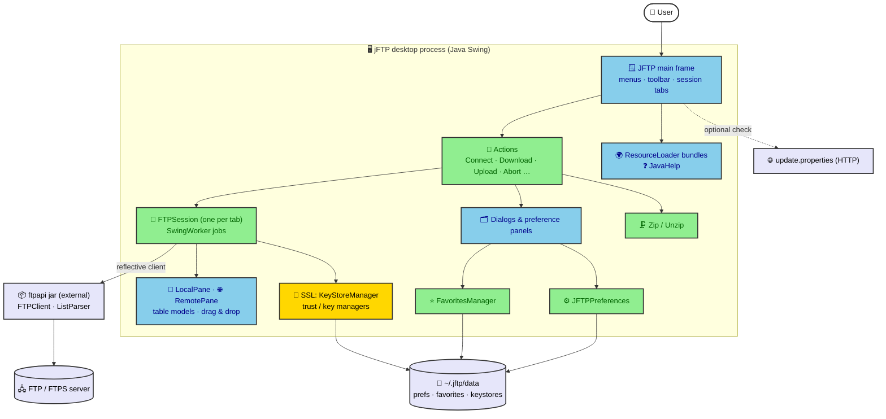
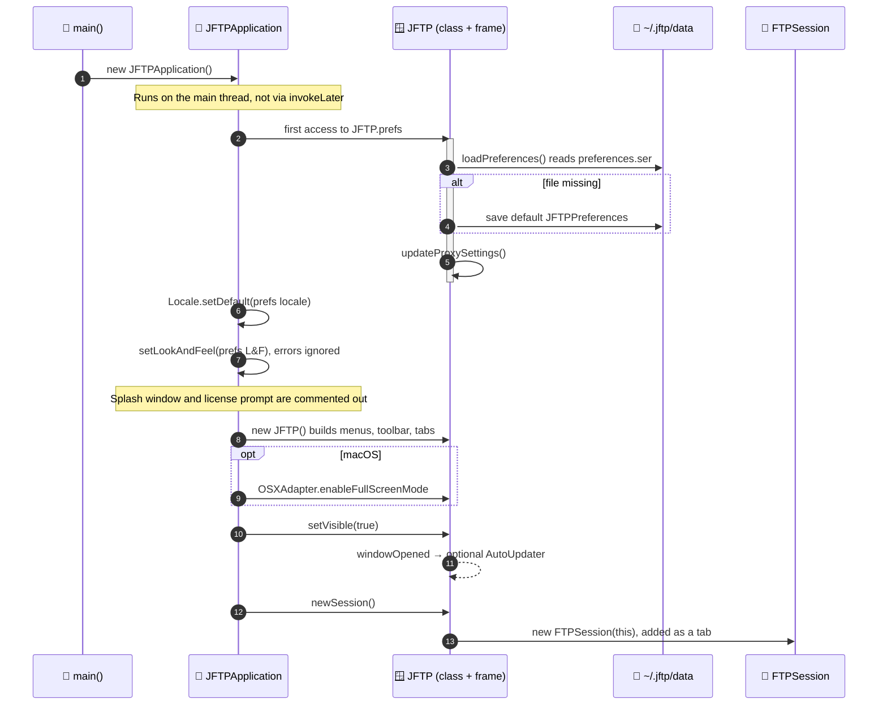
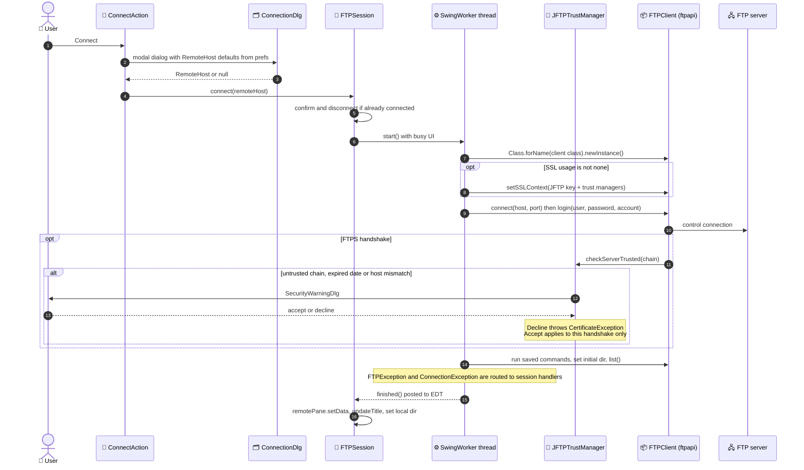
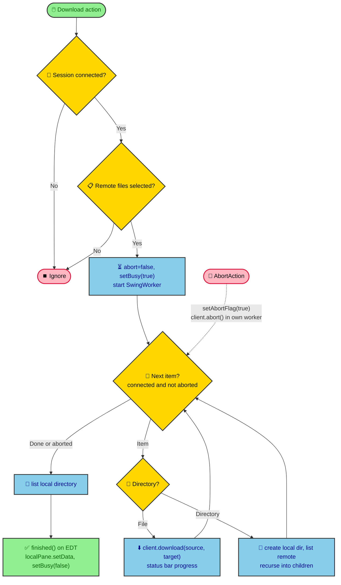
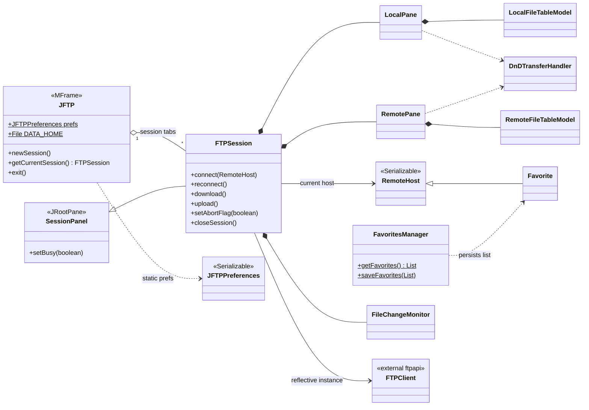
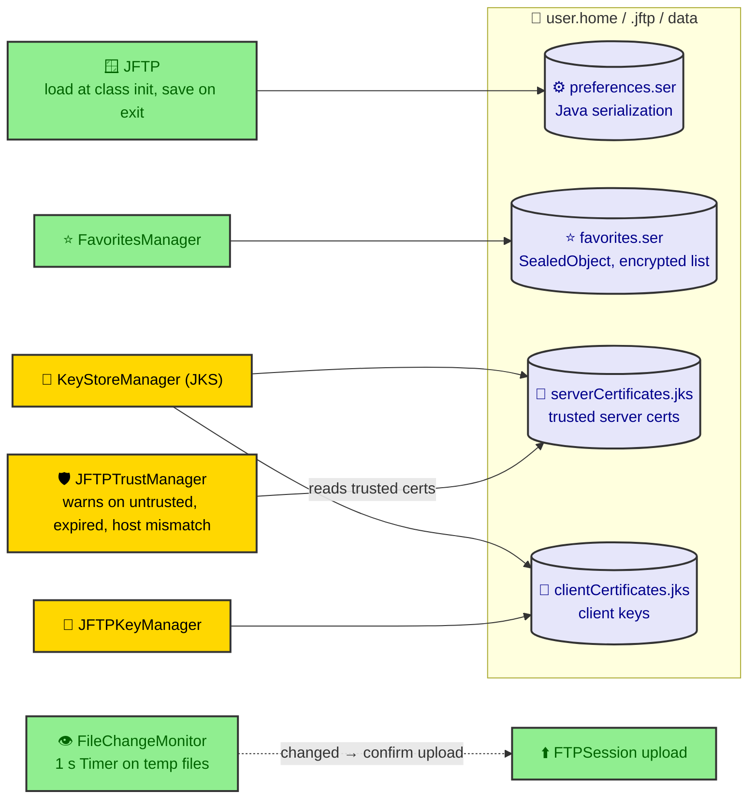

# 🏗️ jFTP Architecture

Observed architecture of jFTP, a Java Swing desktop FTP/FTPS client. Every node and edge below comes from original source, recorded in [evidence.json](evidence.json) (62 citations with file, line, SHA-256 and quotation, all verified with the legacy-codebase-workflows citation checker).

| | |
|---|---|
| 📌 Documented revision | `64227d2` (application source unchanged since `14e62ce`) |
| ✅ Status legend | **observed** = read in source · **inferred** = follows from source, not executed · **unknown** = outside inspected code |
| 📦 External boundary | `com.myjavaworld.ftp.*` lives in the external `ftpapi` jar; its internals were **not** inspected |
| 🧭 Related | [Code-graph community guide](../code-graph/COMMUNITIES.md) · [Repo map](../repo-maps/repo-map.rust.md) |

## Contents
1. 🧩 Components and boundaries
2. 🚀 Startup sequence
3. 🔌 Connect and FTPS trust sequence
4. ⬇️ Download and abort activity
5. 🧱 Core classes (UML)
6. 💾 Persistence and security stores
7. ⚠️ Findings, limits and unknowns

## 1. 🧩 Components and boundaries

One process. The `JFTP` frame hosts menus, a toolbar and one tab per `FTPSession`. Singleton actions delegate to the current session, which runs network work in `SwingWorker` jobs through a reflectively created `FTPClient` from the external `ftpapi` jar. Preferences, favorites and keystores persist under `~/.jftp/data`.

🖼️ Export: [01-components.svg](diagrams/01-components.svg) · [01-components.png](diagrams/01-components.png)

Evidence: `session-new`, `session-tab`, `connect-reflect`, `connect-ssl`, `updater`, `updater-url`, `unzip`, `zip`, `i18n`, `help`, `data-home`.

## 2. 🚀 Startup sequence

🖼️ Export: [02-startup-sequence.svg](diagrams/02-startup-sequence.svg) · [02-startup-sequence.png](diagrams/02-startup-sequence.png)

- ⚠️ Swing work starts on the **main thread** (no `invokeLater`) — observed (`startup-frame`).
- `JFTP.prefs` loads in a static initializer, so the first `JFTP.prefs` access reads or creates `preferences.ser` (`prefs-static-load`, `prefs-default`).
- Splash screen and license prompt are commented out (`startup-splash-off`, `license-off`).

## 3. 🔌 Connect and FTPS trust sequence

🖼️ Export: [03-connect-sequence.svg](diagrams/03-connect-sequence.svg) · [03-connect-sequence.png](diagrams/03-connect-sequence.png)

- Client and list-parser classes come from `RemoteHost` and are instantiated with `Class.forName(...).newInstance()` (`connect-reflect`).
- `construct()` runs on a new thread, `finished()` is posted to the EDT (`worker-thread`, `worker-edt`).
- The warning dialog appears for an untrusted chain, an invalid date **or** a host mismatch. Accepting keeps the chain for this handshake only; no keystore write happens in `checkServerTrusted` (`ssl-conditions`, `ssl-accept` — inferred).
- `checkServerTrusted` is called by the JSSE handshake inside `ftpapi`; the exact moment is **unknown** (external jar).

## 4. ⬇️ Download and abort activity

🖼️ Export: [04-download-activity.svg](diagrams/04-download-activity.svg) · [04-download-activity.png](diagrams/04-download-activity.png)

- Abort is cooperative: the flag is checked between items, and `client.abort()` runs in its own worker (`abort-flag`, `abort-call`, `dl-loop`). How `ftpapi` stops an in-flight transfer is **unknown**.
- Directories are created locally and downloaded recursively (`dl-mkdir`, `dl-recurse`).

## 5. 🧱 Core classes (UML)

Only verified relationships; methods shown are a selection.

🖼️ Export: [05-core-classes.svg](diagrams/05-core-classes.svg) · [05-core-classes.png](diagrams/05-core-classes.png)

Evidence: `session-base`, `sessionpanel-base`, `local-model`, `remote-model`, `dnd`, `fav-type`, `fav-sealed`, `fcm-temp`.

## 6. 💾 Persistence and security stores

🖼️ Export: [06-persistence.svg](diagrams/06-persistence.svg) · [06-persistence.png](diagrams/06-persistence.png)

- All state is Java serialization or JKS under `user.home/.jftp/data` (`data-home`, `prefs-file`, `prefs-oos`, `fav-file`, `ks-jks`, `ks-default`). Store paths are configurable in preferences.
- Edited remote files are downloaded to temp files and polled every second; a change prompts a re-upload (`fcm-temp`, `fcm-timer`, `fcm-confirm`).

## 7. ⚠️ Findings, limits and unknowns

| | Finding | Status |
|---|---|---|
| 🧵 | UI is built on the main thread, not the EDT | observed |
| 🌐 | Update check uses plain HTTP to `update.properties` | observed |
| 🔑 | Default keystore password constant `changeit` | observed (`ks-password`) |
| 🧹 | `SplashWindow`, `MDesktopPane`, `MInternalFrame`, `JFTPApplet` are never instantiated in `src/main/java` (reflection/resources not searched) | observed, scoped search |
| 📦 | `ftpapi` internals (sockets, TLS, abort) | unknown |
| 🙈 | `connect()` worker ends in `finally { return null; }`, which suppresses any uncaught throwable | observed (`connect-finally`) |

**Not covered:** upload, edit/print/email, zip internals, preferences dialogs, i18n bundles and help content beyond their wiring. Runtime behavior was **not** executed; these views come from source reading.

## ♻️ Regenerate

Sources: `diagrams/*.mmd` (fences above are byte-identical). Rendered with Mermaid CLI 11.4.2 and Google Chrome; emoji need a colour-emoji font (Noto Color Emoji) on the rendering machine. After source changes, re-check the cited lines (`check_citations.py <repo> docs/architecture/evidence.json`) and update the `.mmd`, fences and exports together.
